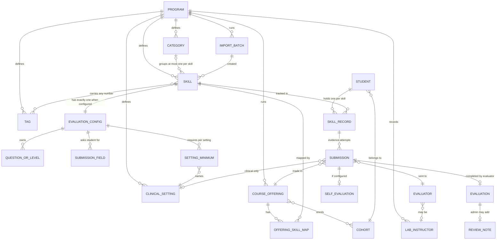
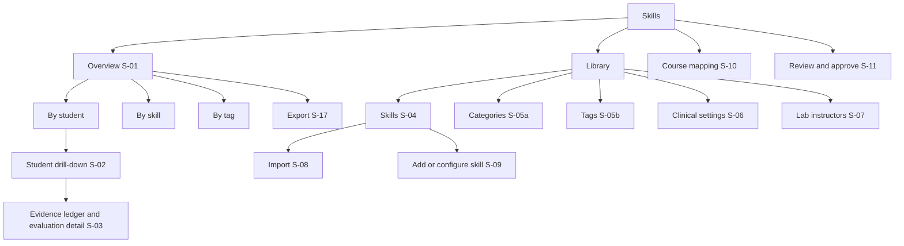

# UX 03 — Information Architecture

> **OD numbering:** OD-01..OD-13 come from the requirements document §13. OD-14..OD-24 and OD-P1 are PROPOSALS by this documentation pack (see `docs/source/proposed-ids.txt`), not requirements-document decisions.

Tags per `docs/README.md`: `[REQ id]` `[OD-n]` `[PROTO]` `[CALL 09-23]` `[CALL 03-05]` `[INFER]`. Precedence REQ > CALL > PROTO > INFER. Nothing here decides an open decision; each OD is handled by the seam in `docs/strategy/05-open-decisions.md`.

Surface IDs: S-01 Overview · S-02 Student drill-down · S-03 Evidence ledger + evaluation detail · S-04 Library Skills list · S-05 Categories/Tags · S-06 Clinical settings · S-07 Lab instructors roster · S-08 Import · S-09 Skill configure · S-10 Course mapping · S-11 Review & approve · S-12 Student course skills · S-13 Student send for review · S-14 Student skill history · S-15 Student my skills · S-16 Evaluator form (tokenised) · S-17 Export · S-18 Evaluation-request email.
Personas: P-A admin · P-S student · P-P preceptor · P-F clinical faculty · P-L lab instructor · P-R reviewer (an administrator acting in the approval role `[REQ §8]`).

## 1. Object model

### 1.1 Entity diagram



Entity names are `[INFER]` (the REQ gives capability, not a schema); every relationship is backed by a REQ id below.

### 1.2 Nouns, ownership, cardinality

| Noun | Owned by | Cardinality rule | Source |
|---|---|---|---|
| Skill | Program | name, description, active/inactive; at most 1 category; any number of tags | `[REQ SL-02, SL-03, SL-04]` |
| Category | Program | optional per skill; created inline allowed | `[REQ SL-03, SL-05]` |
| Tag | Program | cross-cutting, spans categories | `[REQ SL-04, SL-05]` |
| Evaluation configuration | Skill | exactly one model, chosen explicitly | `[REQ SC-02]` |
| Student submission field | Skill config | label, data type, mandatory flag; OD-04 decides per-skill vs program default | `[REQ SC-13]` `[OD-04]` |
| Setting minimum | Skill config | per named clinical setting, counted per setting | `[REQ SC-11]` |
| Clinical setting | Program list | describes where clinical evidence was gathered | `[REQ SL-07]` |
| Lab instructor | Program roster, not a Prism user | name + email | `[REQ SL-08]` `[OD-05]` |
| Course offering | Program (from other Prism modules) | code, name, term, academic year, professional year, cohorts | `[REQ CM-01]` |
| Offering skill map | Offering x Skill | mandatory or non-mandatory, may differ per offering | `[REQ CM-03, CM-06]` |
| Skill record | Student x Skill | exactly one per skill, shared across courses | `[REQ CM-07, AE-05]` |
| Submission | Skill record | numbered attempts; carries course, setting, location, evaluator, role | `[REQ ST-05, ST-06, SH-01]` |
| Self-evaluation | Submission | only if skill configured for it | `[REQ SC-15, ST-11]` |
| Evaluation | Submission | immutable once complete | `[REQ RV-03]` |
| Review note | Evaluation | optional, retained | `[REQ AR-04]` |
| Import batch | Program | repeatable; each skill traceable to its import | `[REQ IM-11]` |

Prose: Skill is the root of the library side (definition, configuration, mapping). Skill record is the root of the student side (one record, many attempts, many courses). The two meet only through evidence: every submission carries its course, so reports can slice by course without forking the record `[REQ CM-07]`. Mapping (Offering x Skill) never gates submission `[REQ CM-05]`.

## 2. Sitemaps per role

### 2.1 Admin (P-A, P-R)



Review and approve appears only if at least one skill has administrator approval switched on `[REQ SC-15]` `[PROTO]` ("Evaluations appear here only for skills where the program turned on administrator review").

### 2.2 Student (P-S)

```
Course page (existing Prism student course)
 └─ Course activities                         [CALL 09-23: "course activities ... forms, evaluations, patient logs, then skills"]
     └─ Skills (this course)  S-12
         ├─ Mapped to this course: Mandatory · Non-mandatory   [REQ ST-01, CM-03]
         ├─ Other skills (not mapped)                          [REQ ST-02, CM-05]
         ├─ Send for review  S-13   (sheet or dialog, opened from selection)   [REQ ST-04]
         └─ Skill history  S-14      (per skill, narrow to this course)         [REQ SH-01, SH-06]
My skills  S-15  (all courses, one record per skill)           [REQ SH-06, AE-05]
 └─ Skill history  S-14  (all courses by default)
```

Placement: Skills is a section inside the course page plus a cross-course My skills view `[INFER]` drawing on `[CALL 09-23]` and `[REQ SH-06]`. Whether My skills is a top-level student nav item or lives under a profile area is not specified.

### 2.3 Evaluator (P-P, P-F, P-L) — no shell

```
S-18 Evaluation-request email   ──link──▶   S-16 Evaluator form (tokenised)
                                              ├─ one request, one or many skills       [REQ EV-05]
                                              ├─ student context + self-evaluation     [REQ EV-04]
                                              └─ submit ▶ "counts now" or "held for approval"   [REQ EV-07]
(no sidebar, no navigation, no account, nothing else reachable)       [REQ EV-01]
```

Faculty may also open the same form inside Prism `[REQ §7 intro]`; that variant reuses S-16 in the Prism shell (faculty already work inside Prism). Lab instructors are not Prism users `[REQ SL-08]`.

## 3. Navigation model

| Layer | Pattern | Notes |
|---|---|---|
| Admin primary | One top-level "Skills" group with four children: Overview, Library, Course mapping, Review & approve | `[PROTO]` uses the same four; REQ is silent on nav |
| Library secondary | Tabs: Skills, Categories, Tags, Clinical settings, Lab instructors | Mirrors REQ §2 lists `[PROTO]`; tabs are an `[INFER]` choice |
| Overview | Three views as tabs: By student, By skill, By tag | `[REQ RP-02, RP-03, RP-04]` |
| Detail | Student drill-down opens as a side panel over Overview; evaluation detail opens as sheet over the ledger | Keeps place in the report `[REQ RP-06]` ("without leaving the report") |
| Configure | Own route or large sheet rather than a small modal | `[INFER]` heavy form with live preview `[REQ SC-19]`; the prototype used a modal `[PROTO]` |
| Import | Dialog for input, full-width review step | Review table is the trust moment `[REQ IM-05]` |
| Student | Section in course page + My skills | See 2.2 |
| Evaluator | Single page, no chrome | `[REQ EV-01]` |
| Breadcrumb | Used once, not duplicated by a back button | workspace design rule `[INFER]` |
| Unconfigured banner | After import, a count with "Show them" jumping to Library filtered by Needs configuration | `[REQ IM-10]` `[PROTO]` |

Placement of the whole module is **OPEN (OD-P1)**: standalone product apps (`admin` port 3007, `student` port 3008 per product CLAUDE.md) versus a section inside existing Prism admin and student apps. All routes below are written relative to a module base `{base}` so the answer does not change them. See `docs/build/01-build-plan.md` §1.

## 4. Route scheme proposal `[INFER]`

`{base}` = module root, to be decided with OD-P1.

| Surface | Route | Role |
|---|---|---|
| S-01 Overview | `{base}/overview?view={student, skill or tag}&{filters}` | P-A |
| S-02 Student drill-down | `{base}/overview/students/{studentId}` (panel over S-01) | P-A |
| S-03 Evidence + evaluation detail | `{base}/overview/students/{studentId}/skills/{skillId}` and `.../evaluations/{submissionId}` | P-A |
| S-04 Skills list | `{base}/library/skills?q=&category=&tag=&status=&batch=` | P-A |
| S-05a Categories / S-05b Tags (two library tabs, each with one filled primary) | `{base}/library/categories`, `{base}/library/tags` | P-A |
| S-06 Clinical settings | `{base}/library/settings` | P-A |
| S-07 Lab instructors | `{base}/library/lab-instructors` | P-A |
| S-08 Import | `{base}/library/import` (and `.../import/{batchId}/review`) | P-A |
| S-09 Skill configure | `{base}/library/skills/{skillId}/configure` and `{base}/library/skills/new` | P-A |
| S-10 Course mapping | `{base}/course-mapping?q=&cohort=&term=&year=&profYear=&skill=` and `.../{offeringId}` | P-A |
| S-11 Review and approve | `{base}/review` and `{base}/review/{submissionId}` | P-A, P-R |
| S-12 Student course skills | `/courses/{offeringId}/skills` | P-S |
| S-13 Student send for review | `/courses/{offeringId}/skills/send` (sheet over S-12) | P-S |
| S-14 Skill history | `/courses/{offeringId}/skills/{skillId}/history` and `/my-skills/{skillId}` | P-S |
| S-15 My skills | `/my-skills` | P-S |
| S-16 Evaluator form | `/evaluate/{token}` (single-use semantics are OPEN, see section 8) | P-P, P-F, P-L |
| S-17 Export | action on S-01, no route (file download) | P-A |
| S-18 Request email | not a route; contains the S-16 link | system |

Rules: filters live in the query string so a report view is shareable and each applied filter is removable on its own `[REQ RP-01]`; ids never appear in tokenised routes other than the token.

## 5. Cross-linking rules

| From | To | Rule | Source |
|---|---|---|---|
| Any aggregate figure (S-01) | Individuals behind it | Every count is a link carrying the current filters | `[REQ RP-05]` |
| Student row (S-01) | S-02 | Opens panel | `[REQ RP-05]` |
| Skill in S-02 | S-03 ledger | Expands in place | `[REQ RP-06]` |
| Ledger row | Evaluation detail | Full responses, not a summary | `[REQ RP-07]` |
| By-skill row | Students for that skill | Aggregate to individuals for skills; not observed in prototype | `[REQ RP-05]` `[PROTO]` |
| Library "Courses" count on a skill (S-04) | S-10 filtered to offerings mapping that skill | The count must equal the mapped-offering count | `[REQ CM-04]` `[INFER]` |
| S-10 "Also mapped in ..." chips | The other offering in S-10 | Reinforces one shared record | `[REQ CM-07]` `[PROTO]` |
| S-10 mapped skill name | S-09 for that skill | Edit configuration from mapping | `[INFER]` |
| Unconfigured skill row (S-04) | S-09 | "Configure"; unconfigured skills are absent from S-10 and S-12 | `[REQ IM-09]` |
| Tag chip (S-04) | S-04 filtered by that tag; Tags tab shows spread across categories | `[REQ SL-04, RP-04]` |
| Student-named lab instructor (S-07) | Adopt into roster | `[REQ SL-09]` |
| S-11 queue item | S-03 evaluation detail | "See the full responses" | `[REQ AR-03]` |
| S-12 skill | S-14 history | Narrow to this course or all courses | `[REQ SH-06]` |
| S-14 attempt | Evaluation detail | Full completed evaluation | `[REQ SH-07]` |
| S-14 returned attempt | S-13 revise form | Same record continues | `[REQ RV-02]` |
| Filter combination with no evidence | Explanation panel with a link to clear the offending filter | Never an empty table | `[REQ RP-09]` |

## 6. Labelling system (REQ terminology, used exactly)

| Concept | Use | Do not use | Source |
|---|---|---|---|
| Library | "Skills library" | "Catalog", "Checklist" as the module noun | `[REQ SL-01]` |
| Not yet configured | "Unconfigured" / "Needs configuration" | "Draft", "Incomplete" | `[REQ IM-09, IM-10]` `[PROTO]` |
| Evaluation models | Overall Binary Outcome · Question-Level Qualitative · Scored / Likert · Demonstration-Level Outcome | Renamed or merged labels | `[REQ §4.1]` |
| Binary labels | Program-defined; default Met / Unmet | Fixed Pass/Fail | `[REQ SC-03]` |
| Requirement level | Mandatory · Non-mandatory | "Recommended", "Optional" (the call said recommended; REQ governs, conflict C-3) | `[REQ CM-03]` |
| Setting | "Clinical setting" for inpatient etc.; "Lab or simulation" as where performed | Mixing "location" and "setting" | `[REQ SL-07, ST-05]` |
| Location | The placement site where it happened | Using location for setting | `[REQ ST-06]` |
| Evaluator roles | Preceptor · Clinical faculty · Lab instructor | "Supervisor", "Mentor" (domain skill) | `[REQ EV-02]` `[OD-06]` |
| Outcome of a submission | Counted · Did not meet the criteria · Returned · Waiting (name who) | "Rejected", "Failed" | `[REQ SH-02]` |
| Attempt vs revision | "Attempt n" for further attempts; "Revised and resent n times" for corrections | Using one word for both | `[REQ RV-02, RV-03, SH-01]` |
| Skill record status | No evidence yet · Evidence does not qualify · In progress (some qualifying evidence) · Achieved | "Not met" for the first two together (OD-03) | `[REQ AE-04]` `[OD-03]` |
| Review decision | Approve · Return | "Return to preceptor" (see DEFECT-03 and OD-16) | `[REQ AR-05]` `[OD-16]` |
| Self-evaluation | "Self-evaluation" | "Self-rating" | `[REQ ST-11]` |
| Notes | "Student note" vs "Evaluator comment" vs "Review note" | Collapsing the three | `[REQ ST-12, SC-14, AR-04]` |
| Skills vs competencies | Skill = observable, narrower | Using competency language for skills | `[REQ §1.1, §1.4]` |

Copy tone follows the workspace standard: professional, no em-dashes, no colloquialisms `[memory: professional microcopy]`.

## 7. Search and filter taxonomy per surface

| Surface | Search | Filters | Sort | Source |
|---|---|---|---|---|
| S-01 Overview | Student name | Cohort, group (needs cohort first `[PROTO]`), clinical course, category, tag, location, setting; each removable; applied set visible | Highest attainment, lowest attainment, name | `[REQ RP-01, RP-08]` |
| S-04 Skills list | Skill name | Category (incl. none), tag, status (Active, Needs configuration, Inactive) | Name, status | `[REQ SL-10]` |
| S-05 Categories/Tags | Name | Active/inactive | Name | `[INFER]` |
| S-07 Lab roster | Name, email | Active/inactive; section "Named by students" | Name | `[REQ SL-09]` |
| S-10 Course mapping | Course code or name | Cohort, term, academic year, professional year | Course, term | `[REQ CM-02]` |
| S-10 skill panel | Library search inside the panel | Mapped, mandatory | Name | `[PROTO]` |
| S-11 Review queue | Student, skill | Course, evaluator role, agreement (agreed or differed) | Date submitted | `[INFER]` from `[REQ AR-01, AR-02]` |
| S-12 Course skills | Skill name | "Show only skills I have sent for review"; Mandatory, Non-mandatory | Mandatory first | `[REQ ST-03]` |
| S-12 Other skills | Library search across all active configured skills | Category, tag | Name | `[REQ ST-02, ST-03]` (volume risk, search not observed `[PROTO]`) |
| S-14 History | none | All courses vs this course | Newest attempt first | `[REQ SH-06]` |

Unconfigured and inactive skills never appear in student selection `[REQ IM-09, SL-11]`.

## 8. Command palette entries

| Label | Route | Group | Notes |
|---|---|---|---|
| Skills overview | `{base}/overview` | Skills | |
| Skills library | `{base}/library/skills` | Skills | |
| Import skills | `{base}/library/import` | Skills | action |
| Add skill | `{base}/library/skills/new` | Skills | action |
| Skills needing configuration | `{base}/library/skills?status=unconfigured` | Skills | shows count `[REQ IM-10]` |
| Categories and tags | `{base}/library/categories` | Setup | |
| Clinical settings | `{base}/library/settings` | Setup | |
| Lab instructors | `{base}/library/lab-instructors` | Setup | |
| Course mapping | `{base}/course-mapping` | Skills | |
| Review and approve | `{base}/review` | Skills | only when approvals exist |
| Export attainment | action on S-01 | Skills | `[REQ RP-10]` |
| (student) My skills | `/my-skills` | Student | |
| (student) Course skills | `/courses/{offeringId}/skills` | Student | per course in scope |

Skill and student names are also searchable entities in the palette `[INFER]`.

## 9. Permissions matrix (surface x role)

R = read, W = write/act, — = none. FERPA scoping per `docs/strategy/06` section 4.

| Surface | P-A admin | P-R reviewer | P-S student | P-P preceptor | P-F faculty | P-L lab instructor |
|---|---|---|---|---|---|---|
| S-01 Overview | R | R | — | — | — | — |
| S-02 Student drill-down | R | R | — | — | — | — |
| S-03 Evidence + evaluation detail | R | R | R (own only) via S-14 | — | — | — |
| S-04 Skills list | R/W | R | — | — | — | — |
| S-05 Categories/Tags | R/W | — | — | — | — | — |
| S-06 Clinical settings | R/W | — | — | — | — | — |
| S-07 Lab instructors | R/W | — | — | — | — | — |
| S-08 Import | W | — | — | — | — | — |
| S-09 Configure | W | — | — | — | — | — |
| S-10 Course mapping | R/W | — | — | — | — | — |
| S-11 Review and approve | R | W | — | — | — | — |
| S-12 Course skills | — | — | R/W own | — | — | — |
| S-13 Send for review | — | — | W own | — | — | — |
| S-14 History | — | — | R/W own (resend) | — | — | — |
| S-15 My skills | — | — | R own | — | — | — |
| S-16 Evaluator form | — | — | — | W via token | W via token or Prism | W via token |
| S-17 Export | W | R | — | — | — | — |
| S-18 Request email | — | — | — | receives | receives | receives |

Notes: sub-roles within administrator (who may configure versus approve) are not specified `[REQ]`, gap G-8 in `docs/strategy/07`; P-R is shown separately only to keep the matrix honest, it is an administrator acting in approval `[REQ §8]`. The evaluator sees only the one request behind the token; whether they see the student's resulting achievement is OPEN `[OD-17]`. Students see no peer data `[INFER]`.

## 10. What lives where and why

| Thing | Lives in | Why | Source |
|---|---|---|---|
| Defining what a skill is | S-04, S-09 | Library is program-defined | `[REQ SL-01]` |
| Categories, tags, settings, lab roster | Library tabs | Supporting lists drawn on when evidence is recorded | `[REQ §2]` |
| How a skill is evaluated and what achievement requires | S-09 only | Configuration is separate from creation | `[REQ SC-01]` |
| Which skills a course expects | S-10 only | Expectation per offering | `[REQ CM-03]` |
| A student's progress in one course | S-12 | Know what the course expects | `[REQ ST-01]` |
| A student's whole record for a skill | S-15 and S-14 | One record per skill across courses | `[REQ SH-06, AE-05]` |
| Sending evidence | S-13 launched from S-12 | Student owns the trigger | `[CALL 03-05]` |
| Authority over the outcome | S-16 | Evaluators record against criteria they cannot change | `[REQ EV-03]` |
| Internal quality check | S-11 | Only for skills that need it | `[REQ SC-15, AR-01]` |
| Proof behind a number | S-03 | Evidence retained, not just status | `[REQ §1.2, RP-07]` |
| Population attainment | S-01 | Cohort, group, course level view | `[REQ §11]` |
| Skill-to-competency link | Nowhere in v1 | Boundary undecided; keep a nullable seam | `[OD-02]` |
| Batch grid (students x skills), hierarchy, QR, heatmaps, learning contract, remediation, notifications | Nowhere | Not in REQ or out of scope | `[REQ §14]` `[OD-19]` `[OD-20]` `[OD-23]` |

## 11. Open points that affect IA

| Point | Effect |
|---|---|
| OD-P1 standalone app vs section of Prism | All route bases, nav mounting, shell for S-16 |
| OD-01 mapping carry-forward | Whether S-10 gains a catalogue default layer; seam: optional catalogue id |
| OD-03 four vs three states | Labels and columns in S-01, S-02, S-12 |
| OD-07 setting/location per submission or per skill | S-13 layout; seam: setting on each submission item defaulting from the submission |
| OD-17 evaluator sees achievement | Post-submit content of S-16 |
| OD-18 link lifecycle | S-16 error states and a resend control |
| OD-14 partial save | Whether S-13 needs a drafts list in S-12 |
