# UX 04 — User Flows F-01 to F-14 and the end-to-end swimlane

Tags per `docs/README.md`. Precedence REQ > CALL > PROTO > INFER. EC-n refers to `docs/strategy/06-states-and-edge-cases.md` section 2. Surface IDs S-01..S-18 and personas P-A, P-S, P-P, P-F, P-L, P-R are defined in `docs/ux/03-information-architecture.md`.
No flow decides an open decision. Where one is touched, both branches or the seam from `docs/strategy/05-open-decisions.md` are shown. Everything in REQ section 14 stays out.

Legend for diagrams: rectangles are steps, diamonds are decisions, rounded nodes are exits. Requirement IDs sit in the node text or in each flow's table.

---

## F-01 Seed library by import

| Item | Detail |
|---|---|
| Persona / surface | P-A · S-04 → S-08 → S-04 |
| Trigger | Program holds a list in a spreadsheet, document or PDF `[REQ §3]` |
| Preconditions | Admin has library access; categories optional |
| Happy path | Upload or paste → read → review proposed list → confirm → skills created unconfigured → banner with count → Show them |
| Decision points | Edit, rename, merge, split, discard, add before creating `[REQ IM-05]`; duplicates: skip, replace or keep both `[REQ IM-06]`; accept proposed categories from headings `[REQ IM-07]` |
| Edge / error | Unreadable lines shown with original text `[REQ IM-08]`; zero skills found; all excluded; re-import of existing skill with evidence (EC-27, OD-13); unsupported file; parse failure |
| Exit states | Skills exist as unconfigured, not mappable or submittable `[REQ IM-09]`; or cancelled with nothing created `[REQ IM-13]` |
| Open decisions | OD-12 (interpretation proposes model/criteria; seam: optional `proposedQuestions`), OD-13 (duplicate with evidence) |
| Not shown in prototype | File parsing, merge/split, duplicate resolution UI, per-import traceability `[PROTO]` |

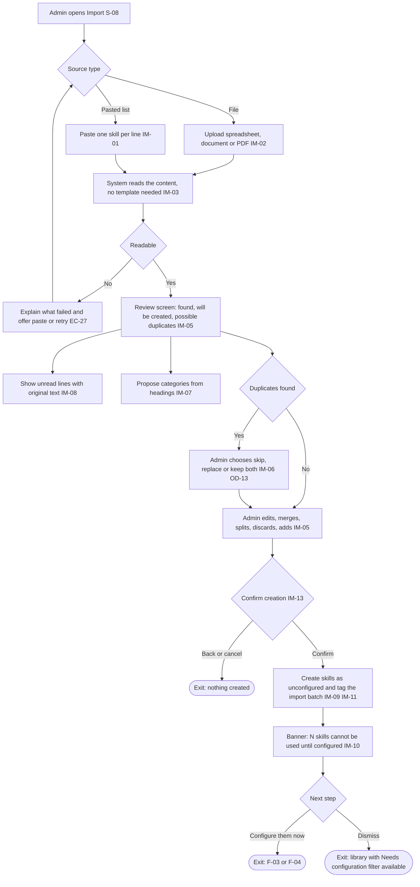

---

## F-02 Create skill manually

| Item | Detail |
|---|---|
| Persona / surface | P-A · S-04 → S-09 step 1 |
| Trigger | Admin chooses Add skill `[REQ IM-12]` |
| Preconditions | None |
| Happy path | Name, description, optional category, tags, status → save → skill exists unconfigured, or continue straight into F-03 |
| Decision points | Create category or tag inline `[REQ SL-05]`; leave unconfigured vs configure now `[REQ SC-01]` |
| Edge / error | Duplicate name; deactivated category or tag not assignable `[REQ SL-06]`; name missing |
| Exit states | Skill saved unconfigured; or configured and ready (F-03) |
| Open decisions | None blocking |

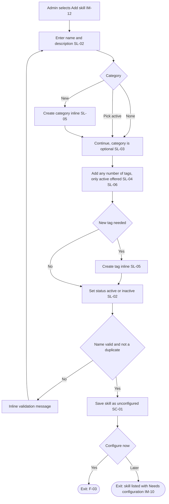

---

## F-03 Configure skill

| Item | Detail |
|---|---|
| Persona / surface | P-A · S-09 steps 2 and 3 plus preview |
| Trigger | Configure on an unconfigured row, or Edit on an existing skill |
| Preconditions | Skill exists `[REQ SC-01]` |
| Happy path | Choose model explicitly → model editor → qualification rule → student submission fields → evaluator comment setting → self-evaluation and approval toggles → allowed evaluator roles → achievement criteria incl. setting minimums → preview everything → save |
| Decision points | Model choice, no default `[REQ SC-02]`; question rule all / at least N of M / named subset `[REQ SC-05]`; scored rule average / minimum per question / total `[REQ SC-07]`; levels and minimums `[REQ SC-10]`; setting minimums `[REQ SC-11]` |
| Edge / error | Changing model rebuilds criteria after confirmation `[REQ SC-09]`; unsatisfiable config not savable `[REQ SC-18]` (EC-2, EC-3, EC-4); empty subset `[REQ SC-06]` (EC-1); editing a skill with evidence re-applies rule `[REQ AE-02]` (EC-6); renaming never changes outcomes `[REQ AE-06]` (EC-7); removing a level or question cascades `[REQ AE-07]` (EC-8) |
| Exit states | Configured and active (usable); configured but inactive; unchanged (cancel) |
| Open decisions | OD-04 (submission fields per skill vs program default; seam: field set referenced by skill), OD-06 (roles as rows), OD-09 (self-evaluation form identical) |

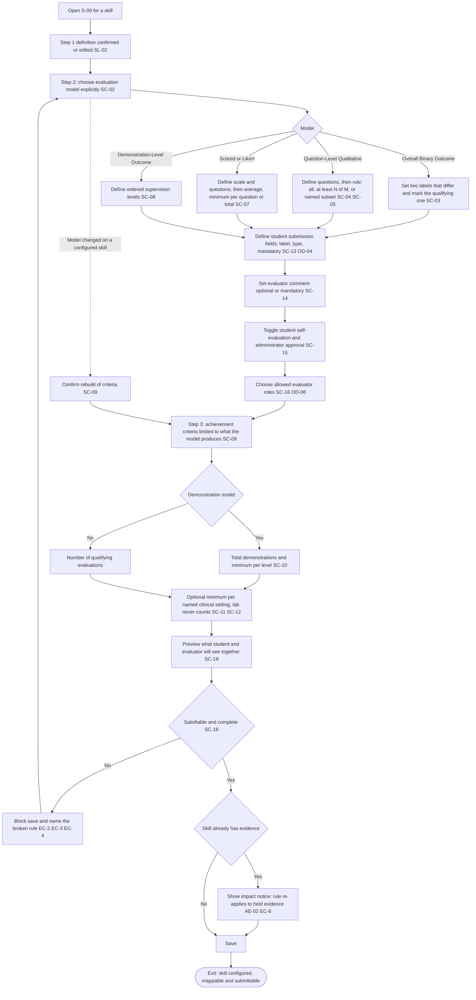

---

## F-04 Bulk configure or copy configuration

| Item | Detail |
|---|---|
| Persona / surface | P-A · S-04 (selection) → S-09 |
| Trigger | Many imported skills share a setup `[REQ IM-14]` |
| Preconditions | At least one configured skill (source) and one or more unconfigured or configured targets |
| Happy path | Select source skill → choose targets (single or multi-select) → choose what to copy → review per-target differences (questions, levels) → apply → each target is individually validated |
| Decision points | Copy whole configuration vs selected parts; overwrite configured targets or only unconfigured |
| Edge / error | A copied rule that references items absent on the target is blocked `[REQ SC-18]`; overwriting a target that has evidence triggers the rule re-application notice `[REQ AE-02]` (EC-6) |
| Exit states | Targets configured (and counted down in the unconfigured total `[REQ IM-10]`) or unchanged |
| Open decisions | OD-04 (a program default field set would reduce repetition). Not observed in prototype `[PROTO]`; this flow is REQ-driven only |

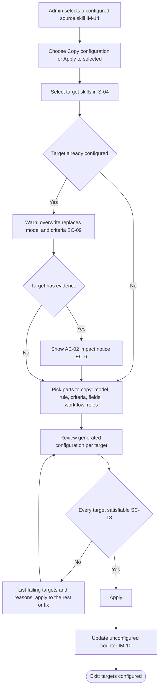

---

## F-05 Map skills to an offering

| Item | Detail |
|---|---|
| Persona / surface | P-A · S-10 |
| Trigger | A course offering needs its expectations set `[REQ §5]` |
| Preconditions | Skills configured and active (unconfigured and inactive are excluded `[REQ IM-09, SL-11]`) |
| Happy path | Find offering by search or filters → open → select skills → set Mandatory or Non-mandatory per skill → counts update |
| Decision points | Requirement level per skill per offering `[REQ CM-03, CM-06]`; carry-forward between terms is undecided |
| Edge / error | Offering with no cohort (shows 0/0 `[PROTO]`); no offerings match filters; remapping a skill that students already submitted (mapping never invalidates evidence `[REQ CM-05, CM-07]`) |
| Exit states | Offering has N mapped, M mandatory `[REQ CM-04]`; student view for that course reflects the change |
| Open decisions | OD-01 (carry-forward; seam: catalogue-level default layer, not built); bulk mapping across many offerings is implied by volume but not required `[INFER]` |

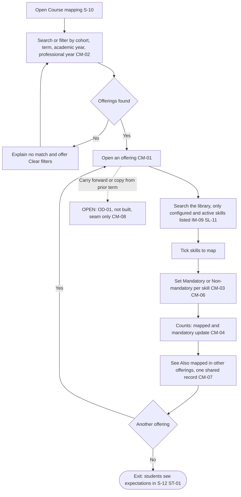

---

## F-06 Student sends skills for review

| Item | Detail |
|---|---|
| Persona / surface | P-S · S-12 → S-13 |
| Trigger | Student performed one or more skills and wants evaluation `[REQ §6]` `[CALL 03-05]` (student-initiated) |
| Preconditions | Student has a login; skills configured and active |
| Happy path | Select skills (mapped or other) → Send for review → performed in clinical or lab → setting and location from placement → role and evaluator → submission details → self-evaluation if configured → send → confirmation |
| Decision points | Clinical vs lab `[REQ ST-05]`; setting choice when several `[REQ ST-06]`; evaluator role constrained by setting and skill `[REQ ST-08]`; named lab instructor not on roster `[REQ ST-09]`; setting and location once per submission or per skill `[OD-07]` |
| Edge / error | No placement recorded, use full settings list (EC-13) `[REQ ST-07]`; no valid role and setting combination, explain why (EC-14); mandatory detail missing, block send `[REQ ST-10]`; stale evaluator after switching mode (DEFECT-01, must reset evaluator when mode changes); several locations (EC-12); lab instructor not on roster (EC-15, EC-16); unmapped skill (EC-11) |
| Exit states | Submission is Waiting with a named evaluator `[REQ SH-02]`; student sees confirmation of what, to whom, role, setting, location `[REQ ST-13]` |
| Open decisions | OD-07, OD-09, OD-14 (save a partial submission) |

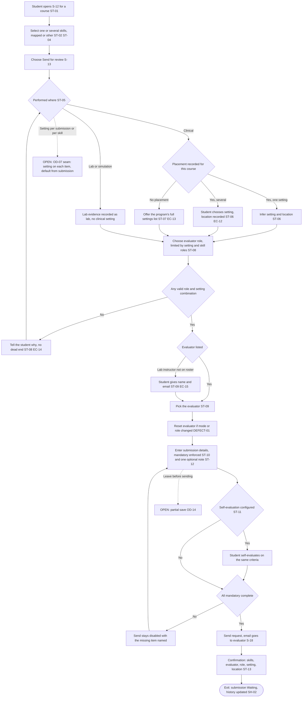

---

## F-07 Evaluator completes the evaluation

| Item | Detail |
|---|---|
| Persona / surface | P-P, P-F, P-L · S-18 → S-16 (no shell) |
| Trigger | Email with a link `[REQ EV-01]` |
| Preconditions | A submission was sent to this evaluator; skill configured |
| Happy path | Open link → see student context, details and self-evaluation → answer each skill as configured → write comment where required → submit → told whether it counts now or is held for approval |
| Decision points | Skill configuration decides the form `[REQ EV-03]`; mandatory feedback `[REQ EV-06]`; approval required or not `[REQ EV-07]` |
| Edge / error | Link invalid or expired, already submitted (EC list gap, OD-18); mandatory comment missing (blocks submit); several skills in one request, all completed in one sitting `[REQ EV-05]`; evaluator unavailable, student re-sends (F-09, EC-17); phone use (persona risk) |
| Exit states | Evaluation Completed; evidence Counted or Awaiting approval; evaluator told which `[REQ EV-07]` |
| Open decisions | OD-17 (evaluator seeing achievement status, DEFECT-05), OD-18 (link lifecycle), OD-06 (roles) |

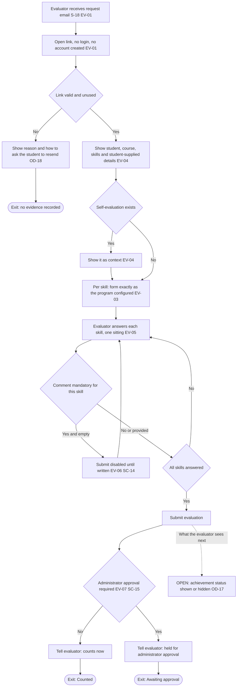

---

## F-08 Administrator approves or returns

| Item | Detail |
|---|---|
| Persona / surface | P-R (administrator) · S-11 → S-03 |
| Trigger | A completed evaluation for a skill with approval on `[REQ §8]` |
| Preconditions | Evaluation completed, held `[REQ AR-06]` |
| Happy path | Open queue → pick item → compare self-evaluation and evaluator, agreement shown → expand full responses → optional review note → Approve → evidence counts |
| Decision points | Approve or Return `[REQ AR-05]` |
| Edge / error | Empty queue; assessments disagree `[REQ AR-02]`; returned evidence does not count; once approved or counted it is locked `[REQ RV-05]` |
| Exit states | Counted (approved) or Returned (does not count, goes back for correction `[REQ AR-05]`) |
| Open decisions | **OPEN OD-16**: does a returned evaluation go back to the student to correct, or to the evaluator to redo? REQ AR-05 says "goes back for correction"; RV-01 gives the student the correct-and-resend path; the prototype labels it "Return to preceptor" while its student view shows "Revise and resend" (DEFECT-03). Both branches shown. Recommendation `[INFER]`: student corrects, because REQ RV-01 and RV-02 define that path and RV-04 lets the student pick a different evaluator. |

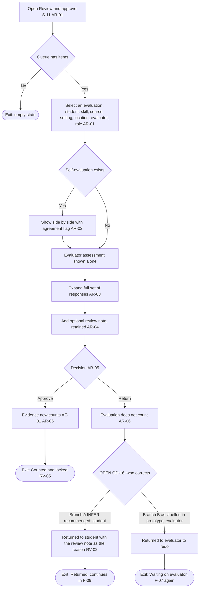

---

## F-09 Student revises and resends

| Item | Detail |
|---|---|
| Persona / surface | P-S · S-14 → S-13 |
| Trigger | Submission was returned, or has not yet been assessed `[REQ RV-01]` |
| Preconditions | Submission is Returned or Waiting; not Counted and not Awaiting approval `[REQ RV-05]` |
| Happy path | Open history → Revise and resend → read reason → correct details or note → optionally pick a different evaluator → resend → same record, revision count +1 |
| Decision points | Keep or change evaluator `[REQ RV-04]`; evaluator answers cleared or prefilled `[OD-08]` |
| Edge / error | Evaluator no longer available (EC-17); attempt to edit a Counted or Awaiting approval item is not offered (EC-20); mandatory detail missing |
| Exit states | Submission Waiting again with "Revised and resent n times" `[REQ RV-02]` |
| Open decisions | OD-16 (this flow is the student branch of F-08), OD-08 (seam: prior evaluation kept as immutable snapshot) |

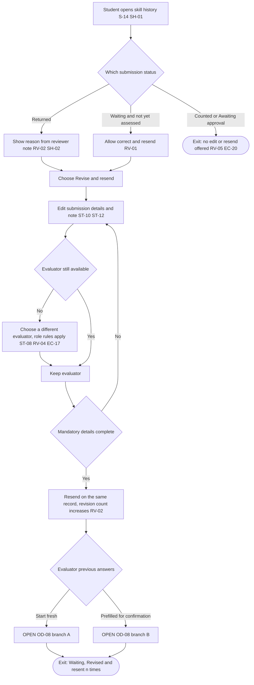

---

## F-10 Student makes a further attempt

| Item | Detail |
|---|---|
| Persona / surface | P-S · S-14 → S-13 |
| Trigger | A completed evaluation did not meet the criteria `[REQ RV-03]` |
| Preconditions | Original evaluation is Did not meet criteria and immutable |
| Happy path | History shows the failed rule in plain terms → student performs the skill again → starts a new submission (new attempt) → original left intact |
| Decision points | Different evaluator allowed `[REQ RV-04]`; setting and role rules unchanged |
| Edge / error | Failed rule must be stated in terms the student can act on `[REQ SH-03]`; no failing example exists in the prototype seed, so wording is untested `[PROTO]`; setting-minimum not yet met although counts are met (DEFECT-07) |
| Exit states | New submission Waiting as Attempt n+1; original shows Did not meet the criteria `[REQ SH-02]` |
| Open decisions | None blocking; wording of failed-rule messages needs content design |

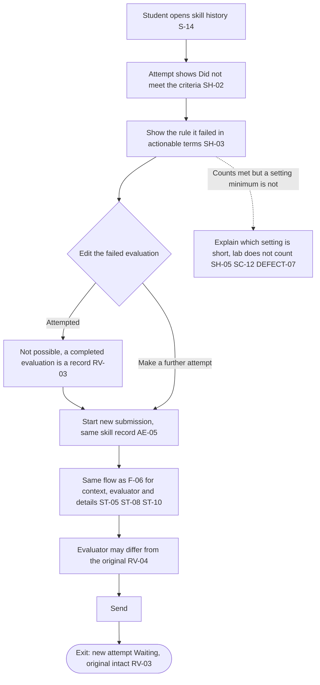

---

## F-11 Report drill-down

| Item | Detail |
|---|---|
| Persona / surface | P-A · S-01 → S-02 → S-03 |
| Trigger | Admin wants attainment across a population `[REQ §11]` |
| Preconditions | Skills configured and some evidence exists |
| Happy path | Open Overview → apply filters → pick view (student, skill, tag) → select a figure or row → reach individuals → open a skill → read the evidence ledger → open full evaluation |
| Decision points | Which view `[REQ RP-02, RP-03, RP-04]`; filters `[REQ RP-01]` |
| Edge / error | Filter combination that cannot produce evidence is explained, not returned empty `[REQ RP-09]` (EC-22); location or setting filter recalculates counting only evidence there `[REQ RP-08]` (EC-23); tags overlap and the report says so `[REQ RP-04]` (EC-21); no students in view; duplicate student names need an identifier (DEFECT-09, EC-26) |
| Exit states | Evaluation detail displayed in full, or return to filtered report with filters intact |
| Open decisions | OD-03 (no evidence vs does not qualify reported separately), OD-11 (evaluator and site dimension exposed) |

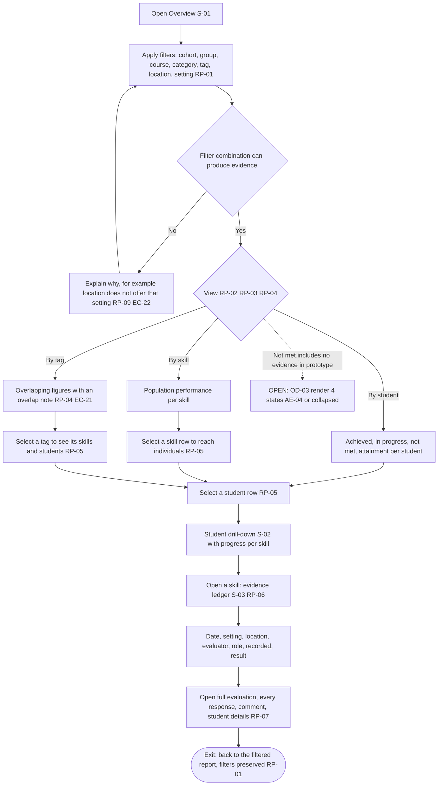

---

## F-12 Export

| Item | Detail |
|---|---|
| Persona / surface | P-A · S-17 from S-01 |
| Trigger | Admin needs the data outside Prism `[REQ RP-10]` |
| Preconditions | A filtered view is open |
| Happy path | Export → choose Aggregate or Evidence detail → file for full filtered scope with filters recorded in the header |
| Decision points | Aggregate (current view) vs row-per-evaluation detail `[REQ RP-10]` |
| Edge / error | Large scope; export covers the full filtered scope, not the visible page `[REQ RP-10]` (EC-24); no data; export in progress |
| Exit states | File downloaded; filters recorded |
| Open decisions | OD-10 (CSV or native Excel; seam: tabular rows with a format adapter), OD-11 (evaluator and site columns). Evidence detail carries feedback, settings, locations, self-evaluations and review notes `[REQ RP-10]`. Download contents not exercised `[PROTO]` |

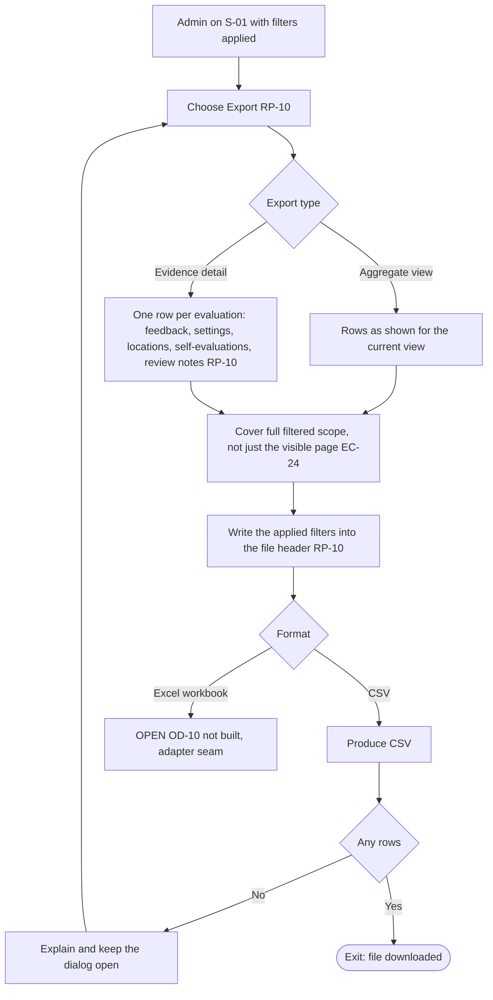

---

## F-13 Adopt student-named lab instructor

| Item | Detail |
|---|---|
| Persona / surface | P-A · S-07 (and student side in F-06) |
| Trigger | A student named a lab instructor not on the roster `[REQ ST-09]` |
| Preconditions | At least one such name exists |
| Happy path | Roster shows "Named by students, not on the roster" → admin reviews name and email → Add to roster → spellings stop accumulating |
| Decision points | Adopt as new, or merge with an existing entry `[REQ SL-09]` |
| Edge / error | Same person spelled differently (EC-16); malformed email; person already on roster as inactive |
| Exit states | Instructor on roster and offered to students for lab sign-off `[REQ SL-07 context, SL-08]` |
| Open decisions | OD-05 (Skills-only record vs Prism-wide external evaluator; seam: standalone external evaluator table). Instructors never get accounts `[REQ SL-08]` |

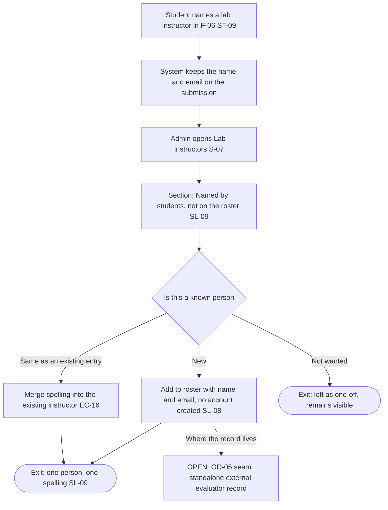

---

## F-14 Deactivate skill, category or tag

| Item | Detail |
|---|---|
| Persona / surface | P-A · S-04, S-05 |
| Trigger | A skill, category or tag is retired `[REQ SL-06, SL-11]` |
| Preconditions | Item exists |
| Happy path | Set to inactive → no longer assignable or selectable; existing evidence retained |
| Decision points | Skill vs category vs tag behave differently |
| Edge / error | Skill: withdrawn from course mapping, student selection and reporting scope while evidence is retained `[REQ SL-11]` (EC-10); category or tag already assigned stays on the skill, shown as inactive, removable deliberately `[REQ SL-06]` (EC-9); deactivating a mapped skill; reactivation. Behaviour not triggered in the prototype `[PROTO]` |
| Exit states | Inactive item; evidence unchanged |
| Open decisions | OD-24 (proposed: in-flight submission when its skill is deactivated; seam: leave the submission in its current state, no new behaviour until decided) |
| Branch F-14b, clinical setting (S-06) `[INFER]`, proposed **OD-26** (docs/strategy/05) | Deactivating a clinical setting that a skill's per-setting minimum references is blocked with a stated reason naming the skills (SC-11 minimums would become unsatisfiable, SC-18); otherwise the setting becomes inactive, is no longer offered to students, and evidence recorded in it is retained. REQ is silent on setting deactivation, so this is a proposal |

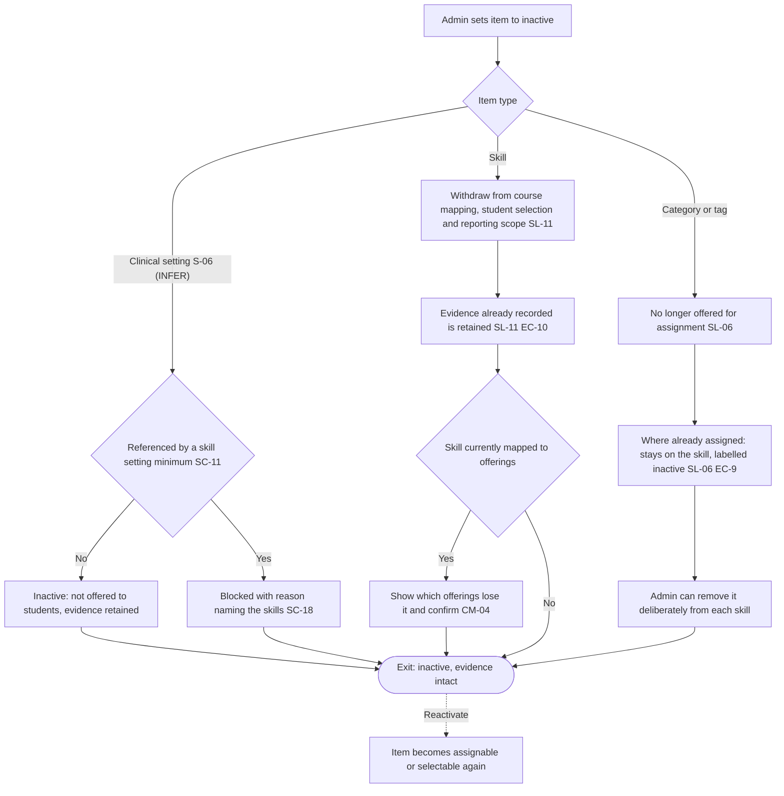

---

## End-to-end swimlane: library to report

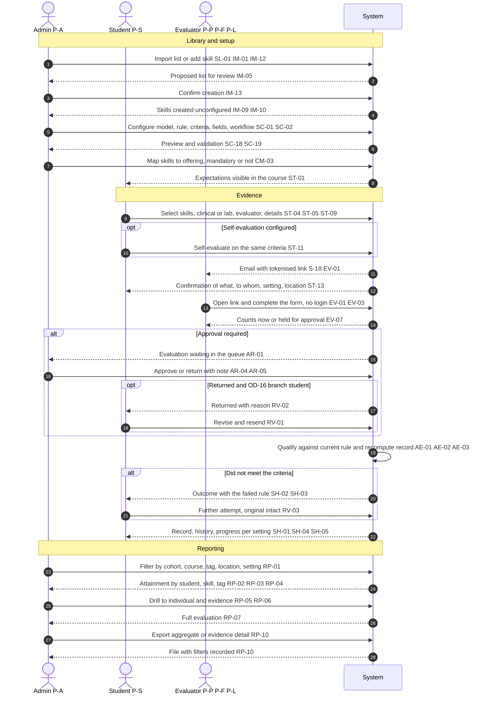

Open decisions that alter this swimlane: OD-07 (setting capture), OD-08 (corrected evaluation), OD-14 (partial save), OD-16 (who corrects a returned evaluation), OD-17 (evaluator-visible status), OD-18 (link lifecycle). Out of scope and absent by design: notifications and reminders, remediation, expiry, encounter linkage, Evaluations migration `[REQ §14]`.

---

## Flow-to-surface-to-requirement index

| Flow | Surfaces | Primary REQ ids | ODs |
|---|---|---|---|
| F-01 | S-08, S-04 | IM-01..IM-13 | OD-12, OD-13 |
| F-02 | S-04, S-09 | SL-02..SL-06, IM-12 | none |
| F-03 | S-09 | SC-01..SC-19, AE-02, AE-06, AE-07 | OD-04, OD-06, OD-09 |
| F-04 | S-04, S-09 | IM-14, SC-18, IM-10 | OD-04 |
| F-05 | S-10 | CM-01..CM-07 | OD-01 |
| F-06 | S-12, S-13, S-18 | ST-01..ST-13 | OD-07, OD-09, OD-14 |
| F-07 | S-16, S-18 | EV-01..EV-07 | OD-06, OD-17, OD-18 |
| F-08 | S-11, S-03 | AR-01..AR-06, RV-05 | OD-16 |
| F-09 | S-14, S-13 | RV-01, RV-02, RV-04, RV-05 | OD-08, OD-16 |
| F-10 | S-14, S-13 | RV-03, SH-02, SH-03, SH-05 | none |
| F-11 | S-01, S-02, S-03 | RP-01..RP-09 | OD-03, OD-11 |
| F-12 | S-17 | RP-10 | OD-10, OD-11 |
| F-13 | S-07 | SL-08, SL-09, ST-09 | OD-05 |
| F-14 | S-04, S-05, S-06 | SL-06, SL-11, SC-11, SC-18 | OD-24 (proposed), OD-26 (proposed: setting deactivation block) |
