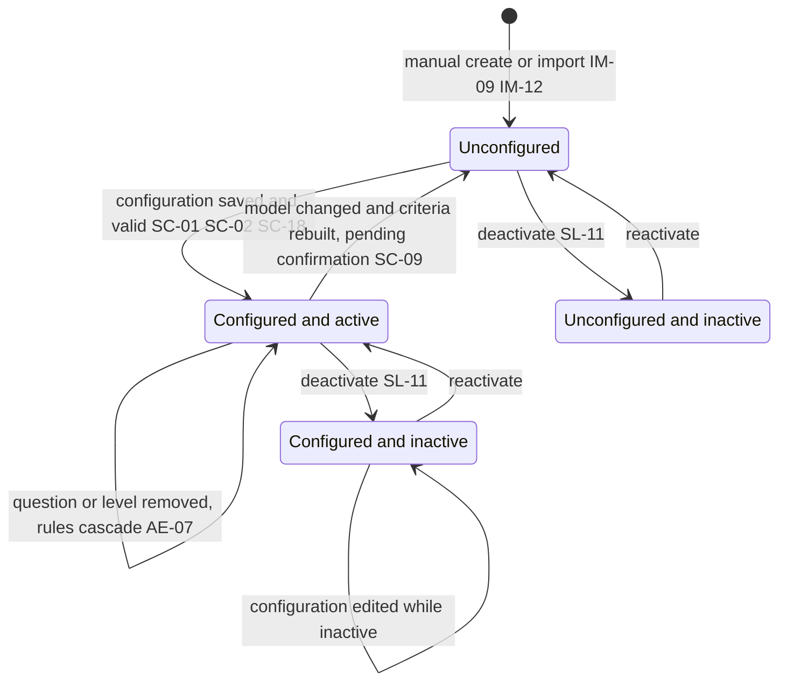
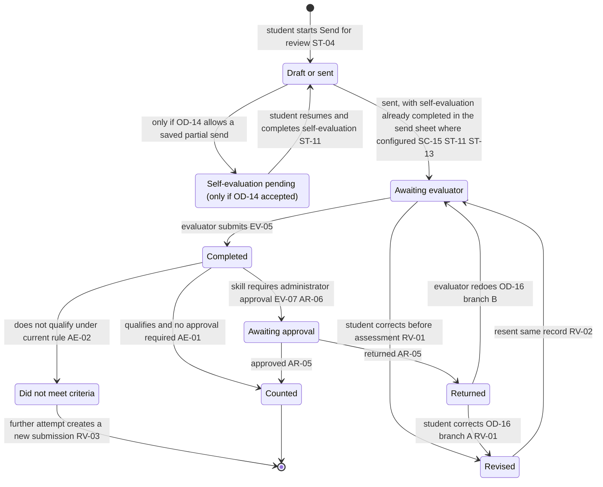
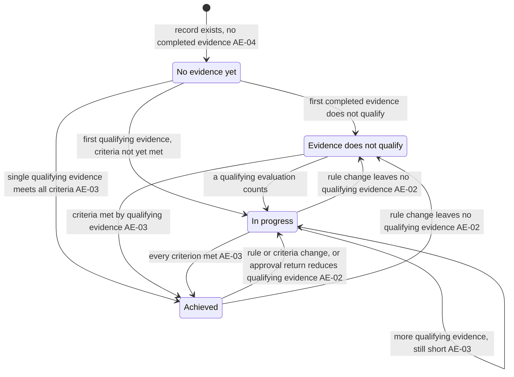
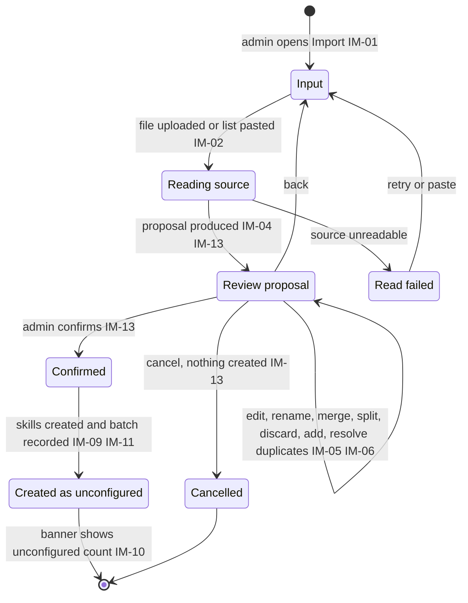

# UX 05 — State Machines SM-01 to SM-04

Tags per `docs/README.md`. Precedence REQ > CALL > PROTO > INFER. State names are `[INFER]` labels for REQ concepts; copy labels follow the labelling system in `docs/ux/03-information-architecture.md` section 6. Nothing here resolves an OD; open points are marked and show both branches or a seam (`docs/strategy/05-open-decisions.md`).
Personas: P-A admin, P-S student, P-P/P-F/P-L evaluators, P-R reviewer (administrator in approval).

Two principles govern all four machines `[REQ §1.5, AE-02, RV-03]`:
1. Evidence is a ledger; status is derived from the ledger and the skill's current rule.
2. A completed evaluation is never edited. Corrections continue the same record; further attempts create a new one.

---

## SM-01 Skill configuration lifecycle

The `Active --> Unconfigured` arrow on model change is `[INFER]`. REQ SC-09 says criteria are rebuilt, not that the skill reverts to unconfigured. A safer reading is that the skill stays configured but flagged until criteria are re-saved; confirm with Sankalp. Do not implement either reading until confirmed.

### States

| State | Meaning | Who sees it | Copy label | Source |
|---|---|---|---|---|
| Unconfigured | Exists in library, no evaluation model chosen; cannot be mapped or submitted against | P-A only | "Needs configuration" (list status), "Not configured" (model column) | `[REQ IM-09, SC-01]` `[PROTO]` |
| Configured and active | Model chosen, criteria satisfiable; usable | P-A; P-S sees it in selection if mapped or any active skill | "Active" | `[REQ SC-02, SL-02]` |
| Configured and inactive | Withdrawn from mapping, student selection and reporting scope; evidence retained | P-A (filtered) | "Inactive" | `[REQ SL-11]` |
| Unconfigured and inactive | Edge combination of the two flags | P-A | "Inactive" plus "Needs configuration" | `[INFER]` |

### Transitions

| Event | Guard | Effect on achievement | Source |
|---|---|---|---|
| Create manually or import | Name present; nothing created without confirmation on import | None, no evidence possible | `[REQ IM-12, IM-13]` |
| Save configuration | Model chosen explicitly; no duplicate or unlabelled questions or levels; subset not empty; minimums not above totals | Skill becomes usable; no prior evidence | `[REQ SC-02, SC-06, SC-18]` |
| Edit rule or criteria | Valid; impact notice shown when evidence exists | Held evidence re-qualified under the new rule; records may move between SM-03 states | `[REQ AE-02]` |
| Rename label, question text or level | None | No change to recorded responses or counts | `[REQ AE-06]` |
| Remove question or level | Rules referencing it are updated | Evidence tagged to the removed level stops counting toward that level but is retained `[PROTO text]`; REQ mandates only the rule cascade | `[REQ AE-07]` |
| Change model | Confirmation; criteria rebuilt | Previously held evidence re-evaluated against the new rule; behaviour for incompatible evidence is undefined in REQ, flag as gap | `[REQ SC-09]` `[INFER]` |
| Deactivate | None | Skill leaves mapping, selection, reporting scope; evidence retained | `[REQ SL-11]` |
| Reactivate | Must still be configured to be usable | Skill returns to scope | `[INFER]` |

### Invariants

- A skill with no evaluation model is never mappable or submittable `[REQ IM-09, SC-02]`.
- Exactly one model per skill at any time `[REQ SC-02]`.
- Saved criteria are always satisfiable `[REQ SC-18]`. This includes role satisfiability `[INFER]`: a skill with a clinical-setting minimum (SC-11) must keep at least one allowed evaluator role valid for clinical evidence (SC-12, SC-16); the validity map is seeded data under proposed OD-25 (docs/strategy/05).
- Deactivation never deletes evidence `[REQ SL-11]`.
- Activation as a separate step beyond configured plus active is not in REQ (OD-15, `[CALL 09-23]` suggested it).

### User-visible label mapping

| Internal | List badge | Banner / helper copy |
|---|---|---|
| Unconfigured | Needs configuration | "N skills in the library have not been configured, so they are not available for mapping or submission." `[PROTO]` |
| Active | Active | none |
| Inactive | Inactive | "Withdrawn from course mapping and student selection. Evidence is kept." `[INFER]` |

---

## SM-02 Submission lifecycle

A submission is one student attempt for a skill: it may be batched with others, but each skill result follows this machine `[REQ ST-04, EV-05]`.

Locked states (no edit, no resend): **Awaiting approval** and **Counted** `[REQ RV-05]`. **Completed** and **Did not meet criteria** are immutable records `[REQ RV-03]`; the only path forward from Did not meet is a new submission (Attempt n+1), not a transition inside this machine. Completed is transient: it resolves immediately into Awaiting approval, Counted or Did not meet.

### States

| State | Meaning | Who sees it | Copy label (SH-02 mapping) | Source |
|---|---|---|---|---|
| Draft or sent | Student is composing or has just sent. Partial save is OPEN | P-S | "Draft" only if OD-14 yields drafts; otherwise unseen | `[OD-14]` `[INFER]` |
| Self-evaluation pending (CONDITIONAL) | Exists ONLY if OD-14 (save partial) is accepted. Default model: self-evaluation is completed before send, inside the S-13 send sheet, so this state is never reached `[INFER]` | P-S | none by default; if OD-14 accepted: "Continue self-evaluation" affordance on S-12/S-14 and label "Draft" | `[REQ SC-15, ST-11]` `[OD-14]` |
| Awaiting evaluator | With a named evaluator | P-S, P-A | "Waiting, with {name} ({role})" | `[REQ SH-02]` |
| Completed | Evaluator submitted; evaluation locked | P-S, P-A, evaluator | transient | `[REQ RV-03]` |
| Awaiting approval | Held for administrator; excluded from achievement | P-S, P-A, P-R | "Waiting, with administrator review" | `[REQ AR-06, SH-02]` |
| Counted | Counts toward the record | P-S, P-A | "Counted" | `[REQ SH-02, AE-01]` |
| Did not meet criteria | Completed but fails the rule | P-S, P-A | "Did not meet the criteria" plus the failed rule | `[REQ SH-02, SH-03]` |
| Returned | Administrator sent back for correction; does not count | P-S, P-A | "Returned" plus reviewer note | `[REQ AR-05, SH-02, RV-02]` |
| Revised | Student corrected; continues the same record, revision count +1 | P-S | "Revised and resent n times" | `[REQ RV-02]` `[PROTO]` |

### Transitions

| Event | Guard | Effect on achievement | Source |
|---|---|---|---|
| Send for review | Mandatory details complete; role and setting valid; evaluator set | None yet | `[REQ ST-08, ST-10]` |
| Self-evaluation completed (before send, in S-13) | Skill configured for it; Send is disabled until complete | None yet | `[REQ ST-11]` `[INFER]` |
| Evaluator submits | Mandatory comment present where required; all skills in request answered | Evidence becomes completed | `[REQ EV-05, EV-06]` |
| Qualify check | Current rule of the skill | Counted only if it qualifies and no approval pending | `[REQ AE-01, AE-02]` |
| Approval required | Skill setting | Held, excluded | `[REQ SC-15, AR-06]` |
| Approve | Reviewer | Counts; locked | `[REQ AR-05, RV-05]` |
| Return | Reviewer; optional note | Does not count | `[REQ AR-05]` |
| Student correct and resend | Returned or not yet assessed; not Counted or Awaiting approval | Same record continues | `[REQ RV-01, RV-02, RV-05]` |
| Change evaluator on resend | Role rules apply | None | `[REQ RV-04]` |
| Further attempt | Original evaluation Did not meet | New submission, original intact | `[REQ RV-03]` |
| Rule edited later | Skill rule changes | A Counted item may become Did not meet and vice versa because qualification is re-derived, stored responses unchanged | `[REQ AE-02]` |

### Invariants

- Only completed evidence counts; anything awaiting self-evaluation, evaluator or approval does not `[REQ AE-01]`.
- Evidence awaiting approval cannot be edited or resent `[REQ RV-05]`.
- Completed evaluations are never edited `[REQ RV-03]`.
- A returned submission does not count `[REQ AR-05]`.
- Which actor corrects a Returned submission is OPEN: branch A student corrects (REQ RV-01 path, recommended `[INFER]`), branch B evaluator redoes (prototype label "Return to preceptor", DEFECT-03). Whether corrected answers start fresh or prefilled is OPEN `[OD-08]`.
- Counted vs Did not meet is a derived label, not a stored fact `[REQ AE-02]`.

### User-visible label mapping (SH-02)

| Internal state | Student label | Detail line |
|---|---|---|
| Counted | Counted | outcome, evaluator, role |
| Did not meet criteria | Did not meet the criteria | the rule it failed, stated so the student can act `[REQ SH-03]` |
| Returned | Returned | reviewer note as the reason `[REQ RV-02]`, action Revise and resend |
| Awaiting evaluator | Waiting | "with {evaluator name}, {role}" `[REQ SH-02]` |
| Awaiting approval | Waiting | "with administrator review" |
| Self-evaluation pending (only if OD-14 accepted) | Draft | "Continue self-evaluation" `[INFER]` |

Counters on the history header: counted, in progress (sent not finished, i.e. "outstanding"), returned `[REQ SH-04]`. Third counter label is **In progress** in every file (wireframe S-14, microcopy, this table).

---

## SM-03 Skill record status (per student per skill)

The four states of `[REQ AE-04]`. The prototype shows three (Not Started, In Progress, Achieved) and groups state 1 and 2 as "Not met" `[PROTO]`; whether to separate them is **OPEN (OD-03)**. The model below keeps the four states internally (the seam in `docs/strategy/05`) so a display choice does not change storage.

Retained evidence never returns a record to No evidence yet, so no such transition exists `[REQ SL-11]`.

### States

| State | Meaning | Who sees it | Copy label | Source |
|---|---|---|---|---|
| No evidence yet | No completed evidence for the skill | P-S, P-A | "No evidence yet" `[REQ AE-04]` (prototype: "Not started" `[PROTO]`) | `[REQ AE-04]` |
| Evidence does not qualify | Evidence exists but none qualifies | P-S, P-A | "Evidence does not qualify" `[INFER]`; prototype folds into "Not met" | `[REQ AE-04]` `[OD-03]` |
| In progress | Some qualifying evidence, criteria not yet met | P-S, P-A | "In progress" with n / N | `[REQ AE-04]` |
| Achieved | Every criterion met: counts, per-level minimums, setting minimums | P-S, P-A | "Achieved" | `[REQ AE-03, AE-04]` |

### Transitions

| Event | Guard | Effect on achievement | Source |
|---|---|---|---|
| Evidence completes and counts | Approved if required; qualifies under current rule | Increments counts; may advance state | `[REQ AE-01, AE-03]` |
| Evidence completes and does not qualify | Current rule | No count; state 1 → 2 if it was the first | `[REQ AE-02]` |
| Evidence held for approval | Approval on | Excluded, no change | `[REQ AR-06]` |
| Approval returns evidence | Return | Evidence excluded, may regress state | `[REQ AR-05]` |
| Rule or criteria edited | Skill has evidence | Re-derive state for every student | `[REQ AE-02]` |
| Per-level or setting minimum unmet | Demonstration model or setting minimums | Stays In progress even if total met (DEFECT-07: 4/4 but a setting short) | `[REQ AE-03, SC-10, SC-11]` |
| Lab evidence | Setting minimum requires clinical | Lab never satisfies a clinical setting requirement | `[REQ SC-12]` |
| Evidence in another course | Any course | Counts toward the same record | `[REQ CM-07, AE-05]` |
| Skill deactivated | None | Withdrawn from reporting scope, evidence retained | `[REQ SL-11]` |

### Invariants

- One record per student per skill across all courses `[REQ AE-05]`.
- Achieved requires every criterion simultaneously `[REQ AE-03]`.
- State is a function of the ledger and the current rule; nothing here is stored as a fact beyond a cache `[REQ AE-02]`.
- A student can request more evidence after Achieved if the program wants it `[PROTO copy]`.
- Whether reports show 1 and 2 separately is OPEN `[OD-03, AE-08]`; per-setting progress must be shown where settings are required `[REQ SH-05]`.

### User-visible label mapping

| State | Student card | Overview column placement |
|---|---|---|
| No evidence yet | "No evidence yet" | If OD-03 combines: counted under Not met `[PROTO]`; if separated: own column `[INFER]` |
| Evidence does not qualify | "Evidence does not qualify" with the rule | Not met (combined) or own column |
| In progress | "In progress", n / N, per level, per setting | In progress |
| Achieved | "Achieved" | Achieved |

---

## SM-04 Import batch

An unread-lines panel is part of the Review state, not a separate state: every line that could not be interpreted is listed with its original text `[REQ IM-08]`.

### States

| State | Meaning | Who sees it | Copy label | Source |
|---|---|---|---|---|
| Input | Choose upload or paste | P-A | "Import skills" | `[PROTO]` |
| Reading source | System interprets the content, no template required | P-A | "Reading the list" | `[REQ IM-03, IM-04]` |
| Review proposal | Draft only; nothing created. Counters: found, will be created, possible duplicates; proposed categories; unread lines | P-A | "Review N skills found" | `[REQ IM-05, IM-06, IM-07, IM-08, IM-13]` |
| Confirmed | Admin accepted the reviewed list | P-A | transient | `[REQ IM-13]` |
| Created as unconfigured | Skills exist, unusable until configured, tagged to this import | P-A | "Needs configuration" | `[REQ IM-09, IM-11]` |
| Read failed | Source could not be interpreted at all | P-A | explanation with a retry path `[INFER]` | `[INFER]` |
| Cancelled | Left without confirming | P-A | none | `[REQ IM-13]` |

### Transitions

| Event | Guard | Effect on achievement | Source |
|---|---|---|---|
| Upload or paste | Supported source; no prescribed template | None | `[REQ IM-02, IM-03]` |
| Interpretation | Always a proposal | None | `[REQ IM-05, IM-13]` |
| Duplicate detected | Name matches an existing skill | Admin chooses skip, replace or keep both; replace on a skill that has evidence is undecided | `[REQ IM-06]` `[OD-13]` |
| Confirm | At least one included row | Skills created unconfigured; categories created only if accepted | `[REQ IM-07, IM-09]` |
| Cancel | Any time before confirm | Nothing created | `[REQ IM-13]` |
| Re-import | Library already has skills | Adds, never replaces the library; batches distinguishable | `[REQ IM-11]` |
| Interpretation proposes model or criteria | Undecided | Seam only: optional proposed questions; nothing created without confirmation | `[OD-12]` |

### Invariants

- No skill, category or evaluation configuration is created without explicit confirmation `[REQ IM-13]`.
- Unread content is reported with its original text, never silently dropped `[REQ IM-08]`.
- Imported skills are unconfigured, not mappable, not submittable `[REQ IM-09]`.
- Import is additive and traceable per batch `[REQ IM-11]`.
- Interpretation is not perfect and is presented as a draft `[REQ IM-13]`; UI copy must not claim accuracy (conflict C-5 in `docs/strategy/07`).

### User-visible label mapping

| Internal | Shown to admin |
|---|---|
| Review proposal | "Nothing is added until you confirm. Edit, exclude or rename anything before creating." `[PROTO]` |
| Created as unconfigured | "Added N skills to the library. They cannot be used until each one is configured." `[PROTO]` |
| Unread lines | "N lines were not read as skills", each with original text and reason `[REQ IM-08]` `[PROTO]` |

---

## Cross-machine map

| Event | SM-01 | SM-02 | SM-03 |
|---|---|---|---|
| Rule edited on a skill with evidence | Active → Active | Counted and Did not meet re-derive | Every student record re-derived |
| Evaluator submits (no approval) | no change | Completed → Counted or Did not meet | may advance |
| Evaluator submits (approval on) | no change | Completed → Awaiting approval | unchanged until approved |
| Approve | no change | Awaiting approval → Counted | may advance |
| Return | no change | Awaiting approval → Returned | unchanged |
| Skill deactivated | Active → Inactive | existing items unchanged | leaves reporting scope |
| Import confirmed | new skills enter Unconfigured | none | none |

Gaps found while drawing these machines (also reported in the task hand-back): REQ does not say what happens to held evidence when the model changes (SM-01); whether a model change reverts a skill to unconfigured; and no REQ coverage for abandoned or never-opened requests (OD-18, notifications are out of scope `[REQ §14]`).
